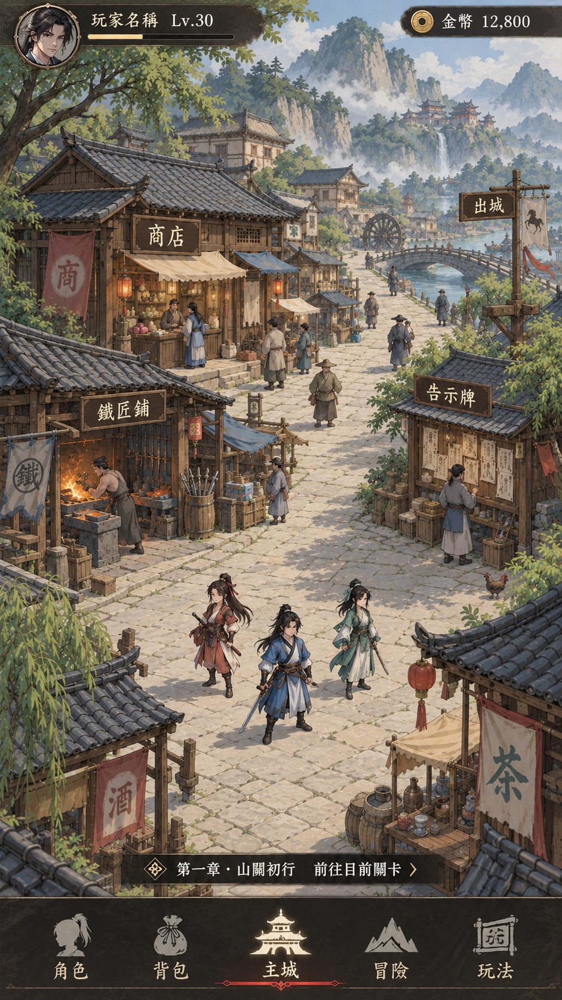
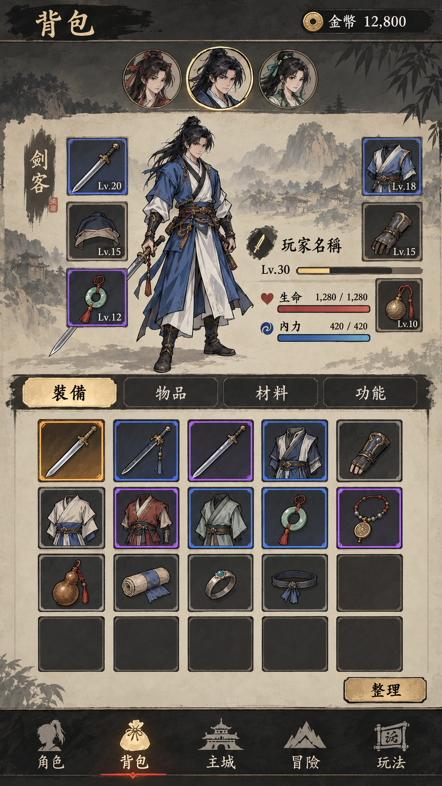

# 《四象江湖傳》全遊戲共同美術方向（2026-10-26 批准版）

> 狀態：使用者已批准「主城＋背包」兩張 Demo 作為全遊戲共同美術參考。此文件只記錄美術語言與驗收依據，不表示 Demo 畫面、數值、功能或佈局已實際導入遊戲。
>
> 產品決議及完整 Q01～Q92 以 [Issue #1001](https://github.com/tf00913225-alt/my-game/issues/1001) 為準；[美術方向批准紀錄](https://github.com/tf00913225-alt/my-game/issues/1001#issuecomment-6411882167) 與[原圖身分及交接紀錄](https://github.com/tf00913225-alt/my-game/issues/1001#issuecomment-6412139953) 提供來源脈絡。本文件不得取代遊戲現有資料及正式 Owner。

## 一、兩張正式參考原圖

### 1. 主城／山關古鎮（最後批准的低 AI 感版本）

- 原檔：`山關古鎮的冒險介面(1).png`
- 正式參考：[`art-reference/20261026-approved-city.png`](art-reference/20261026-approved-city.png)
- 941 × 1672 PNG；SHA-256：`f83b8d057e7111e9349170974290b7dec5abf3ee530730e97b1de388af76d25e`
- 以「簡化、較樸實的山麓武俠商鎮」為場景方向：斜向石板街與自然景深、三名主角及融入建築的功能入口。避免誤用較早期過度精緻的版本。

### 2. 背包（同一畫風的功能頁）

- 原檔：`四象江湖傳｜背包介面(1).png`
- 正式參考：[`art-reference/20261026-approved-backpack.png`](art-reference/20261026-approved-backpack.png)
- 941 × 1672 PNG；SHA-256：`13590f42d995d97727a03d3cd0b640bc3d726762073f1a1cdc93961f6994a9d3`
- 以克制的墨灰、深褐、素紙色、少量古銅／舊金點綴，展示人物、裝備、背包方格、分類與五欄導覽的共通筆觸和資訊層級。

**兩張參考圖須一起比對，不能只挑其中一張。** 未來頁面功能不同，可以採不同布局；應保留一致的線條、色溫、材質感、資訊層級與圖示語言。原始 PNG 在 `docs/art-reference/` 僅供設計對照，**不是 runtime 遊戲素材**。

## 二、全遊戲共同視覺語言

1. **世界與筆觸**：古代東方武俠、成熟而樸實的 2D RPG 手繪感；人物、建築、植被、器具、物品 Icon、背景與介面具有相容的線條粗細、描邊與陰影方式。
2. **細節與 AI 感**：控制屋瓦、石板、布料、植被等細碎紋理和光影密度；避免過度精修、寫實 3D、塑膠光澤、強烈耀光、華麗粒子，以及不同來源美術直接拼貼。
3. **色彩**：以墨黑、深褐、米白／素紙色與節制的朱紅、舊金點綴為基底；色溫和飽和度須與兩張批准圖協調。必要的元素色、品質／稀有度色仍遵守正式遊戲規範，不得為統一畫風改動識別意義。
4. **UI 元件**：標題、底導航、按鈕、頁籤、彈窗、邊框與狀態標示採一致視覺規則。避免厚重或過度裝飾的框線淹沒內容；操作與資訊可讀性優先。
5. **可用性**：核心固定 1080 × 1920、9:16 邏輯畫布與既有唯一 Display Fit Owner；不另外新增 PC 16:9 專用版。圖片保持比例、觸控範圍與文字大小按 [UI_GUIDELINES.md](../UI_GUIDELINES.md) 驗證。
6. **跨頁延伸**：主城、背包、角色、佈陣、戰鬥、技能、裝備、商店、任務、探索、活動等新美術或翻新內容，以兩張圖的共同語言延展；不因為參考某個版面就照抄其構圖或虛構系統。

## 三、施工前與美術驗收

新美術方案／素材須同時對照兩圖，逐項檢查：

- 人物、物件與建築的線條、陰影、景深、筆觸是否協調；
- 色溫、飽和度、紋理密度、光暈與金色裝飾是否克制；
- Icon、邊框、頁籤、按鈕、導航是否同源且易辨識；
- 9:16 畫面安全區、字體可讀性、操作區大小、圖片比例與裁切是否符合正式 UI 規範；
- 既有角色、美術與功能 Owner 能否沿用，是否新增不必要的重複元件、wrapper 或 CSS 補丁。

不一致的方案應先修正；確需破例時記錄差異與理由，交由使用者批准。**不可只以「比較好看」或「AI 畫得更精緻」當作驗收通過依據。**

## 四、規格與素材邊界

- Demo 內的 **Lv、生命／內力、金幣、道具名稱、分類、裝備格數、功能文字與未實裝的互動**皆可能只是視覺佔位；不能因此新增／變更正式數值、經濟、功能、資料模型或導航行為。
- 具體產品選項以 [Issue #1001](https://github.com/tf00913225-alt/my-game/issues/1001) 的 Q01～Q92 決議為準；實裝前須核對最新 `dev`、正式程式 Owner、[UI_GUIDELINES.md](../UI_GUIDELINES.md) 與必要的其他規格。
- 本文件與兩張 PNG 只在 `docs/` 作設計參考；不改 `index.html`、CSS、JavaScript、asset registry、manifest 或遊戲程式，不代表任何 runtime／實機驗收。
- 日後真要把圖片導入遊戲，遵照 [docs/IMAGE_ASSET_SPEC.md](IMAGE_ASSET_SPEC.md)：原則上先轉**無損 WebP**，檢查像素、透明度、裁切、解碼及 runtime 引用，再循正式 Owner 和 PR／CI 流程施工。**不得直接把這兩張整頁 Demo PNG 當成可用的遊戲 UI。**
